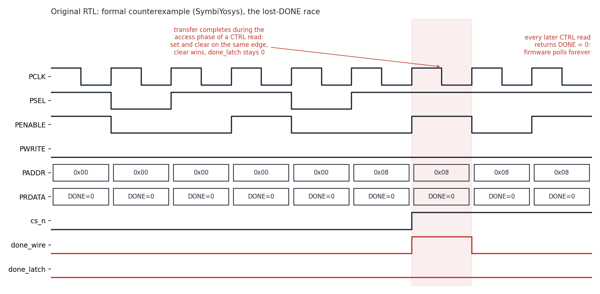

# APB-to-SPI Bridge Controller


An AMBA APB slave that drives an 8-bit SPI master in all four SPI modes, written in Verilog. It's verified with:

- a constrained-random testbench;
- formal proofs (SymbiYosys);
- coverage closure;
- gate-level simulation of the synthesized and the placed-and-routed netlists.

It's implemented on a Lattice iCE40 FPGA.

## Design

```
            APB bus                                   SPI pins
  PCLK, PRESETn, PSEL, PENABLE,   +----------------+
  PWRITE, PADDR, PWDATA  -------->| apb_spi_wrapper|----> SCK, MOSI, CS_n
  PRDATA, PREADY        <---------|   + spi_master |<---- MISO
                                  +----------------+
```

- **`spi_master.v`:** a 4-state FSM (IDLE, LOAD, TRANSFER, FINISH). It has a clock-enable divider (`CLK_DIV` system clocks per SCK period), shifts MSB first, and supports SPI modes 0–3.
- **`apb_spi_wrapper.v`:** a zero-wait-state APB slave with the register map below. It sets DONE when a transfer completes and clears it on read, shows BUSY while a transfer runs, and ignores START, TX and mode writes while busy.

| Addr | Register | Bits |
|---|---|---|
| 0x00 | TX   | [7:0] R/W: byte to send |
| 0x04 | RX   | [7:0] R: last byte received |
| 0x08 | CTRL | [0] W: START · [1] R: DONE (cleared by the read that returns it) · [2] R: BUSY |
| 0x0C | CFG  | [0] CPOL · [1] CPHA (SPI mode 0–3) |

## Results

| Check | Result |
|---|---|
| Constrained-random regression | **25 runs, 25,525 transfers, 0 errors**: all 4 SPI modes, CLK_DIV = 2, 4, 6, 8, 16 |
| Formal: SPI core (SymbiYosys, ABC PDR) | **Unbounded proof of 10 protocol and data-integrity checks** in all 4 modes, for every data byte |
| Formal: property strength | **11 of 11** deliberately injected RTL bugs caught |
| Formal: full bridge | **Unbounded proof** that every transfer completion reaches the CPU exactly once |
| Coverage (Verilator) | **100% line, branch and toggle** (bus bits [31:8] excluded: not decoded / tied to 0) |
| Lint (Verilator `-Wall`) | Clean for CLK_DIV = 2, 4, 6, 8, 16 |
| Gate-level simulation | Post-synthesis **and** post-place-and-route netlists pass the same random testbench, cycle-identical to RTL |
| iCE40 HX8K (Yosys + nextpnr) | **71 LUT4, 63 flip-flops, 104 logic cells (1%)** |
| Fmax (5 place-and-route seeds) | **183–194 MHz** (target 100 MHz) |

## The bug verification found

The first version passed its directed test, but random testing lost the DONE flag in **about 32% of transfers**. Formal verification produced this 42-cycle counterexample:



1. The CPU's status read samples DONE (via PRDATA) at the end of its setup phase.
2. The read-to-clear happens at the end of the access phase.
3. If the transfer completes in between, "set DONE" and "clear DONE" fire on the same clock edge. The clear was written later in the code, so it won, and the completion was lost.
4. Firmware polling CTRL then hangs forever.

**Fix:** clear DONE only if the value being read actually showed it (`PRDATA[1]`), and give *set* priority over *clear*. Formal now proves no completion can be lost.

## How it's verified

- **Testbench** (`tb/`):
  - an APB bus model that samples PRDATA at the APB-specified edge;
  - an event-driven SPI slave model for all 4 modes;
  - a two-way scoreboard (MOSI bytes vs TX writes, RX reads vs slave replies);
  - protocol monitors: SCK idle level = CPOL, MOSI stable on the sampling edge, exactly 8 sampling edges per transfer, exact SCK half-period;
  - directed tests: register readback, unmapped addresses, corner bytes per mode, BUSY behaviour, writes while busy, reset mid-transfer;
  - random stimulus: data, SPI mode, idle gaps and status-poll spacing.
- **Formal** (`formal/`): black-box properties on the ports, so no RTL edits were needed. The SPI-core harness proves the protocol and data integrity for any byte, any MISO sequence and any mode. The bridge harness builds a legal APB master from free inputs and proves completions are reported exactly once.
- **Implementation** (`syn/`, `gls/`): Yosys synthesizes the design and nextpnr places and routes it. Both resulting netlists are simulated with Yosys's iCE40 cell models.

## Running it

Install [OSS CAD Suite](https://github.com/YosysHQ/oss-cad-suite-build/releases), then:

```bash
make all           # lint, regression, formal, place & route, gate-level sim, coverage (~2 min)
make sim_orig      # the original RTL failing the random regression
make formal_orig   # the original RTL failing formal, with the waveform above
make wave          # view a short run in GTKWave
```

## Layout

```
rtl/        final RTL (spi_master.v, apb_spi_wrapper.v)
rtl_orig/   first version, kept to reproduce the bug
tb/         constrained-random testbench
formal/     SymbiYosys property harnesses and .sby files
syn/        Yosys iCE40 synthesis script and pin file
gls/        gate-level simulation helper
cov/        Verilator coverage harness and report
docs/       counterexample waveform
.github/    CI: the full flow runs on every push
```

*The original RTL design is my own. The verification and implementation flow, and the final versions of the race fix and SPI-mode extension, were developed with help from an AI assistant.*
